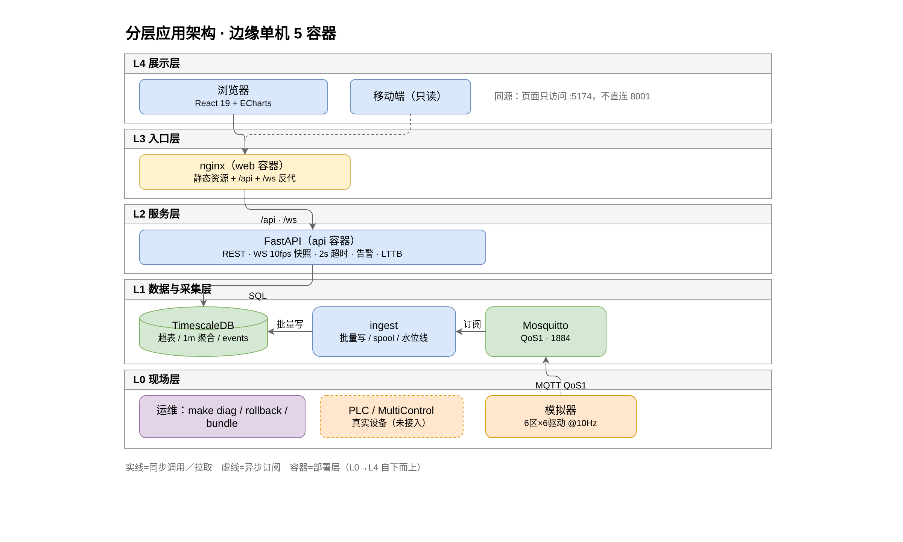

# Interroll PoC · 产线遥测最小闭环

模拟 6 区 × 6 台驱动（360 点/秒）→ MQTT → TimescaleDB → WebSocket → 看板。
断流本地续存、恢复幂等补传、`kill -9` 从 WAL 补回、`make rollback` 12 秒回上一版。

> 这是面试现场用的 **PoC**，不是产品。目标只有三条：一条命令起得来、异常路径不丢数、每处取舍讲得清。
>
> **完整展示（架构图 / 数据流 / 时序 / 界面 / 取舍）见 [`docs/README.md`](docs/README.md)。**

## 六个可复现的数字

| 结论 | 数字 |
|---|---|
| 断流不丢不重 | 0 丢 / 0 重（停 broker 60s）|
| 重连风暴可控 | 峰值 664 → 44 条/秒（调 jitter）|
| 前端不随数据涨而卡 | 1856 点/秒 · 60fps |
| `kill -9` 不丢 | 500 / 500（WAL 回放）|
| 升级失败能回退 | 12 秒 |
| 边缘到中心断链 | 1 秒追平 |



## 快速开始

```bash
make images              # 用 podman 构建镜像（--load 同时导入 docker）
make up                  # 起全栈（用已构建镜像，不现场 build）
make ps / logs           # 看状态 / 跟日志
make verify              # compose + 脚本语法校验
```

## 常用操作

```bash
make demo-offline        # 断网演练：停发 60s → 恢复补传
make diag                # 诊断包 dist/interroll-diag-<ts>.zip（17 个文件，已脱敏）
make rollback TAG=0.3.0  # 切版本重建，等 /healthz 报版本（实测 12s）
make pg-perf             # PG / TimescaleDB 性能体检（只读）
make bundle              # 离线交付包（镜像 + 编排 + 脚本）
make down                # 停栈，保留数据卷
```

> 本机直跑 Python（不起容器）用 `.env.dev`；compose 只读 `.env`，两者不要混。

## 端口（避开宿主机已占用的 1883 / 5432 / 8000）

| 服务 | PoC 端口 | 宿主机已有 |
|---|---|---|
| MQTT | 1884 | 1883 mosquitto |
| TimescaleDB | 5433 | 5432 timescaledb |
| API | 8001 | 8000 |
| Web | 5174 | 5173 |

## 深入

| 想看 | 去哪 |
|---|---|
| 架构图、数据流、时序、界面、取舍 | [`docs/README.md`](docs/README.md) |
| 为什么这么设计 | `docs/adr/` |
| 出问题怎么救 | `docs/runbook/RB-03-排障.md`、`make diag` |
| PG / TimescaleDB 排查 | `docs/runbook/RB-05-PG与TimescaleDB性能排查.md` |
| 任务与进度 | `docs/WBS/` |
| 实测知识卡 | `docs/kb/1-卡/` |

## 目录

```
code/       按交付单元分（一个容器一个目录）：simulator / ingest / api / web / forwarder
deploy/     Docker 编排与运维脚本：compose / db / scripts
docs/       架构、ADR、runbook、kb（分层知识库）、design（设计稿与架构图）、WBS
scripts/    压测与验证脚本（chaos / bench / ws 探针）
```

## 远端约定

| 名字 | 地址 | 用途 |
|---|---|---|
| `origin` | 内网 Gitea | 日常开发，`main` 跟踪它 |
| `github` | `git@github.com:wujunyu/Interroll-poc.git` | 对外发布，显式推 |

`upstream` 留给 fork 别人的项目时用（表示“别人的源仓库”）。
