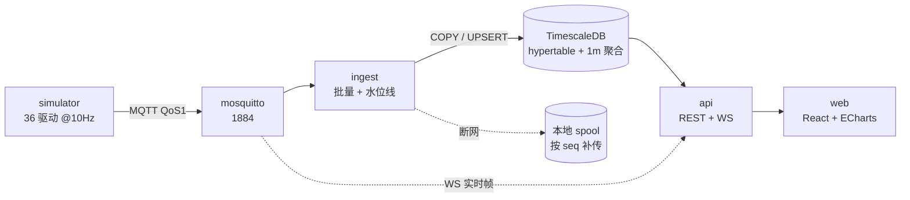

# 架构

## 一张图

## 五个容器，各自的失责点

| 容器 | 只做一件事 | 挂了会怎样 | 怎么发现 |
|---|---|---|---|
| simulator | 造数（可注入断网） | 看板静止 | 只在 demo profile 里 |
| mqtt | 转发 + retain | 边缘断流，spool 顶上 | `/healthz` 检查 Broker |
| ingest | 清洗 + 批量写 + 补传 | 数据积压，spool 涨 | 补传水位线指标 |
| db | 存原始点 + 1m 聚合 | 全线停 | `pg_isready` |
| api/web | 读 + 画 | 只影响展示，不影响采集 | WS 断线提示 |

**关键取舍**：采集链路与展示链路解耦。看板挂了不影响落库，这是「停机就赔钱」场景的底线。

## 量级先算清楚

| 口径 | 算式 | 结果 |
|---|---|---|
| 每拍 | 6 区 × 6 驱动 | 36 点 |
| 每秒 | 36 × 10Hz | 360 点/秒 |
| 每分钟 | 360 × 60 | 21,600 点（= 36 × 600）|
| 每天 | 21,600 × 1,440 | 约 3,110 万点 |

`600` 是单台驱动每分钟的点数，乘的是 **36 台驱动**，不是 6 个区——这是最容易算错的一格。

## 数据流的三段时间

| 段 | 延迟预算 | 手段 |
|---|---|---|
| 设备 → 边缘库 | < 500ms | 批量 200 条或 1s 刷一次，先落库再谈分析 |
| 边缘库 → 看板 | < 1s | WS 推增量，不做轮询 |
| 长窗口查询 | < 200ms | 查 1m 聚合，不扫原始点 |

## 端口

见 `README.md` 端口表；所有端口走 `.env`，默认避开宿主已占的 1883/5432/8000/5173。
