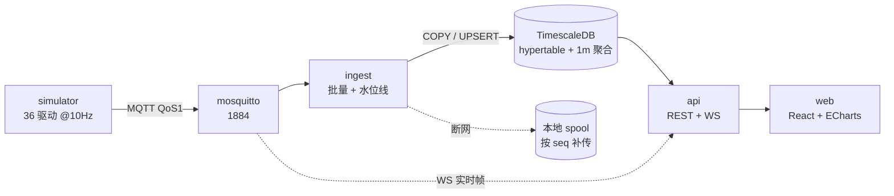

# 架构

## 可编辑的工程图

| 图 | 源文件 | 说明 |
|---|---|---|
| 分层架构 | `docs/design/diagrams/架构-分层.drawio` | L4 展示 → L3 入口 → L2 服务 → L1 数据采集 → L0 现场，含运维横切 |
| 模块调用 | `docs/design/diagrams/架构-模块调用.drawio` | 六个模块之间的调用方向与协议（实线同步 / 虚线订阅）|
| 代码组件 | `docs/design/diagrams/代码-组件关系.drawio` | 函数级模块、模块间调用、四个能力（V1–V4）的落点 |

> 约定见全局 skill `drawio`：先写 `.drawio` 源文件，再渲染；截图不算交付。

## 一张图

## 五个容器，各自的失责点

| 容器 | 只做一件事 | 挂了会怎样 | 怎么发现 |
|---|---|---|---|
| simulator | 造数（可注入断网） | 看板静止 | 只在 demo profile 里 |
| mqtt | 转发 + retain | 边缘断流，spool 顶上 | `/healthz` 检查 Broker |
| ingest | 清洗 + 批量写 + 补传 | 数据积压，spool 涨 | 补传水位线指标 |
| db | 存原始点 + 1m 聚合 | 全线停 | `pg_isready` |
| api/web | 读 + 画 | 只影响展示，不影响采集 | WS 断线提示 |

**关键取舍**：采集链路与展示链路解耦。看板挂了不影响落库，这是「停机就赔钱」场景的底线。

## 量级先算清楚

| 口径 | 算式 | 结果 |
|---|---|---|
| 每拍 | 6 区 × 6 驱动 | 36 点 |
| 每秒 | 36 × 10Hz | 360 点/秒 |
| 每分钟 | 360 × 60 | 21,600 点（= 36 × 600）|
| 每天 | 21,600 × 1,440 | 约 3,110 万点 |

`600` 是单台驱动每分钟的点数，乘的是 **36 台驱动**，不是 6 个区——这是最容易算错的一格。

## 数据流的三段时间

| 段 | 延迟预算 | 手段 |
|---|---|---|
| 设备 → 边缘库 | < 500ms | 批量 200 条或 1s 刷一次，先落库再谈分析 |
| 边缘库 → 看板 | < 1s | WS 推增量，不做轮询 |
| 长窗口查询 | < 200ms | 查 1m 聚合，不扫原始点 |

## 端口

见 `README.md` 端口表；所有端口走 `.env`，默认避开宿主已占的 1883/5432/8000/5173。

## 代码组件与能力落点

一张图看「哪个能力由哪几个独立模块实现」：`docs/design/diagrams/代码-组件关系.drawio`。
下表把图中黄框对应的**具体文件与行号**列出来（改代码后行号会漂，按函数名搜索）。

### V1 断网补传（不丢、不重）

| 模块 | 位置 | 作用 |
|---|---|---|
| `spool_rows()` | `code/ingest/main.py:51` | 写库失败整批落 ndjson |
| `replay_spool()` | `code/ingest/main.py:84` | 流式回放，500 行一块，坏行跳过 |
| `flush()` 失败分支 | `code/ingest/main.py:145` | 触发 spool，标记 `_db_down` |
| `INSERT … ON CONFLICT` | `code/ingest/main.py:43` | 幂等键 `(zone_id, drive_id, ts, seq)` |
| 设备侧 spool | `code/simulator/main.py:34` | `--offline-at/--offline-for`，恢复后限速补发 |
| 表约束 | `deploy/db/init.sql` | 主键即幂等键，重复写入被 DB 挡掉 |

### V2 背压（丢旧不丢新）

| 模块 | 位置 | 作用 |
|---|---|---|
| `ws_live()` | `code/api/main.py:225` | 服务端按 `WS_FPS`（默认 10）节流 |
| `useLive()` | `code/web/src/lib/api.ts:48` | 前端 90ms 再节流一次，避免渲染抖动 |
| `useHistory()` | `code/web/src/lib/api.ts:74` | 环形缓冲 120 点，满则丢最旧 |
| `lttb()` | `code/api/main.py:111` | 超过 1000 点抽稀，保形不保统计 |

### V3 取证（诊断包）

| 模块 | 位置 | 作用 |
|---|---|---|
| `diag.sh` | `deploy/scripts/diag.sh` | 六类证据：system/config/logs/mqtt-tail/db-stats/events |
| `event()` | `code/ingest/main.py:62` | 关键事件写 `events` 表（不是日志流水）|
| `Health.do_GET` | `code/ingest/main.py:197` | `/healthz`：lag / rows / spool / buffer |
| `/healthz` | `code/api/main.py:143` | 版本、MQTT 连接、库水位 |
| `log_setup.py` | `code/{ingest,api}/log_setup.py` | JSON 日志 + `faulthandler` 崩溃栈 |

### V4 升级回滚

| 模块 | 位置 | 作用 |
|---|---|---|
| `rollback.sh` | `deploy/scripts/rollback.sh` | 校验镜像存在 → 改 `APP_VERSION` → 重建 → 轮询 `/healthz` 报版本 |
| `compose.yaml` | `deploy/compose/compose.yaml` | `image: ...:${APP_VERSION}` + `pull_policy: never` |
| `build-images.sh` | `deploy/scripts/build-images.sh` | podman 构建，tag 即版本 |
| `bundle.sh` | `deploy/scripts/bundle.sh` | 离线包（镜像 + 编排 + 脚本），现场可回滚到包内任意 tag |
