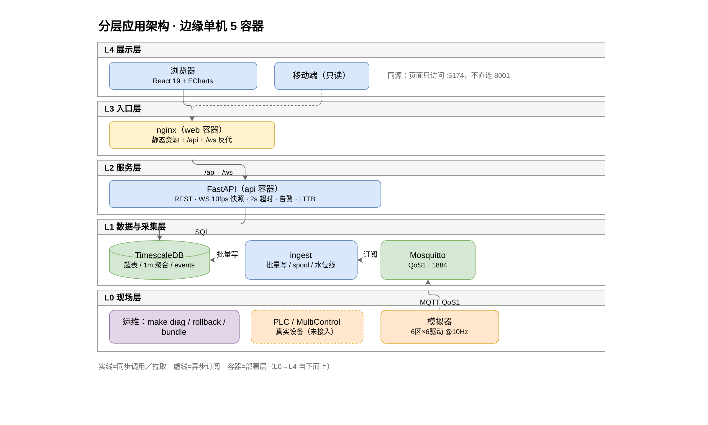
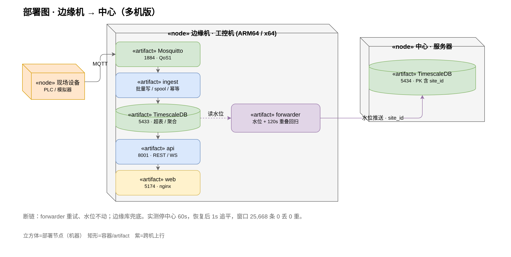
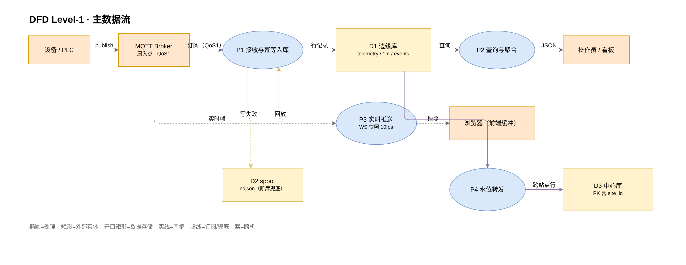
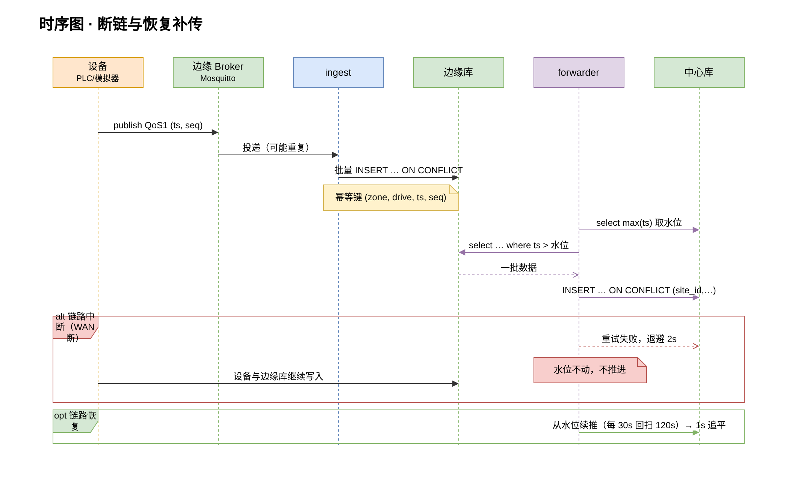
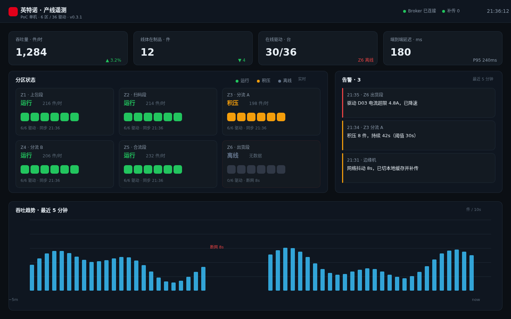
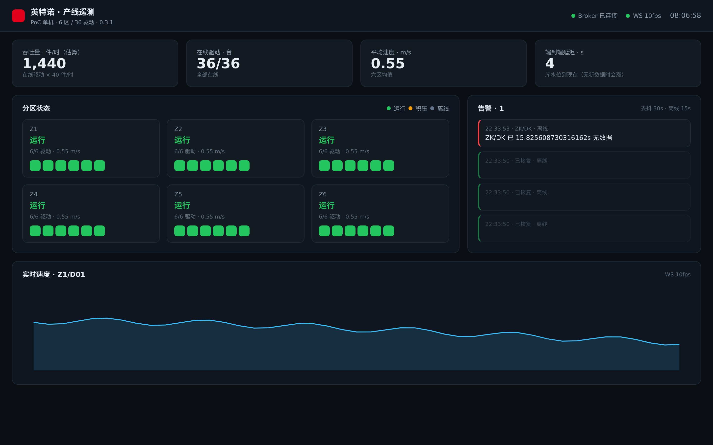
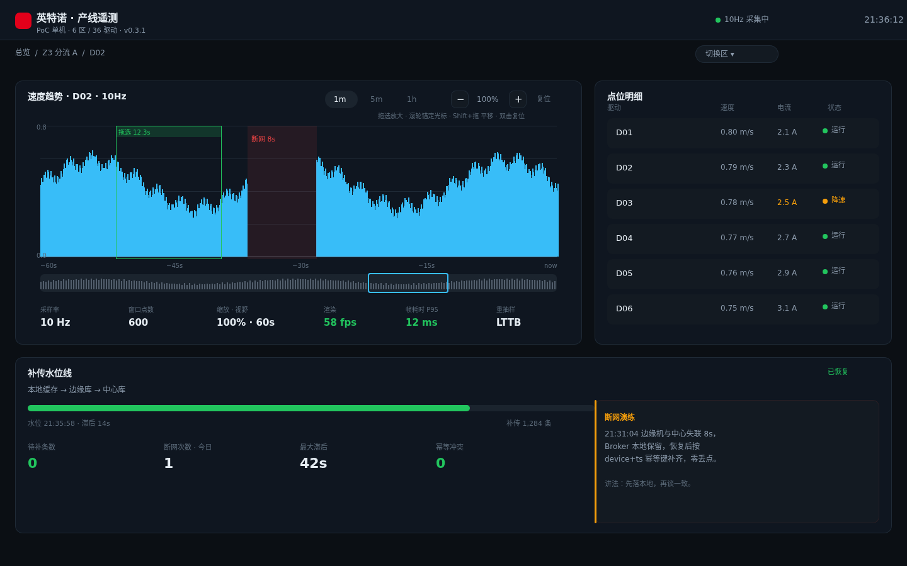
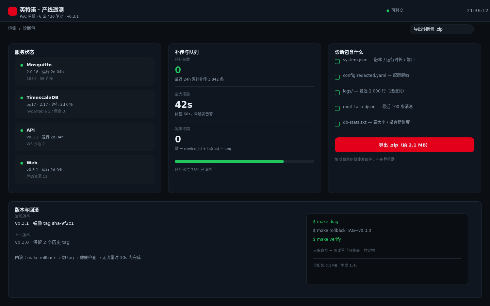
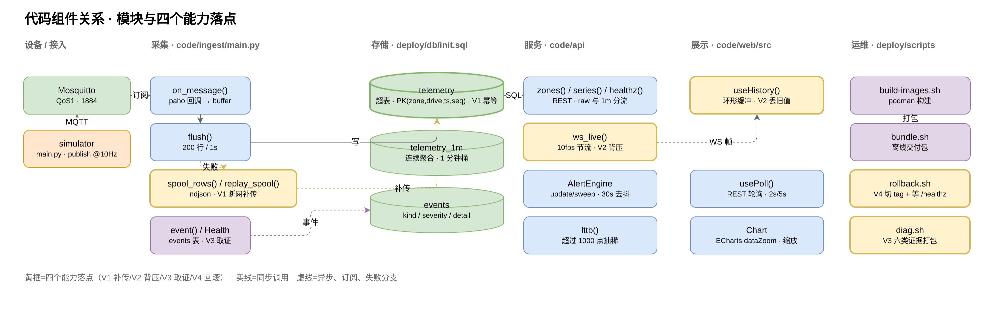

# 英特诺产线遥测 · PoC

> 一台工控机跑通「36 台驱动 @10Hz → 边缘库 → 看板」，
> 并在**断流、崩溃、跨机、回滚**四件事上留下可复现的数字。

---

## 为什么做这个

面试 JD 的四件事——React / Python / MQTT / TimescaleDB + 容器化现场部署——刚好能拼成一条链。
所以这个 PoC 不是"做个系统"，而是**把这条链的异常路径走一遍**：

- 一条命令起得来（`make up`，6 个容器）；
- 断流、崩溃、跨机、回滚，每条都有可复现的数字；
- 每处取舍能讲清代价（见下方"六个关键取舍"）。

**不做的**：多租户、权限系统、K8s、PLC 协议栈。理由写在 `docs/adr/`——
48 小时的 PoC，每加一个东西都要问"它能帮我讲清哪个取舍"。

---

## 三分钟看懂

| 结论               | 数字                   | 怎么证明的                             |
| ---------------- | -------------------- | --------------------------------- |
| 断流不丢不重           | **0 丢 / 0 重**        | 随机停 broker 60s，窗口内边缘与库逐条对齐        |
| 重连风暴可控           | 峰值 **664 → 44 条/秒**  | 360 条独立连接，调 `--jitter` 三档对照       |
| 前端不随数据涨而卡        | **1856 点/秒 · 60fps** | headless Chrome 采样 rAF 与 longtask |
| 进程被 `kill -9` 不丢 | **500 / 500**        | 发 500 条后杀进程，WAL 回放补齐              |
| 升级失败能回退          | **12 秒**             | 坏版本 503 → unhealthy → 切 tag       |
| 边缘到中心断链          | **1 秒追平**            | 停中心 60s，水位续推，窗口零缺失                |

---

## 一条链

```
36 台驱动 @10Hz ──MQTT──> 边缘 Broker ──> ingest ──批量写──> TimescaleDB ──> 看板
                                              │                  │
                                         WAL 预写日志        forwarder（水位）
                                                                  ↓
                                                             中心库（site_id）
```



## 多机形态

边缘机 5 个容器，中心只有库；跨机上行**不用 MQTT bridge**，用应用层水位转发——
因为 WAN 断几小时，broker 队列扛不住，只有落地库才不怕断。



## 数据流

椭圆是处理、矩形是外部实体、开口矩形是存储。



| 处理 | 职责 |
|---|---|
| P1 接收与幂等入库 | 从 Broker 订阅，逐条追加 WAL，攒批 `ON CONFLICT` |
| P2 查询与聚合 | REST 查 `telemetry` / `telemetry_1m` |
| P3 实时推送 | WS 10fps 全量快照（36 点 ≈ 4.8KB） |
| P4 水位转发 | 独立进程 `forwarder`，按 `max(ts)` 推送 + 120s 回扫 |
| P7 WAL 回放 | daemon 线程，崩溃/断库后从游标补数据 |

## 一次断链的时序



---

## 界面

设计稿用 Penpot 出四屏，实现用 React + ECharts；**设计稿先定信息层级，再对着实现**。

| 设计稿 | 实际运行 |
|---|---|
|  |  |

单区曲线（600 点波形 + 缩放）与诊断页：




---

## 代码怎么分层



六个容器：`mqtt` / `ingest` / `db` / `api` / `web` / `forwarder`（可选 profile）。
没有共享库——**复制小段代码优于抽象**，这是 48 小时项目的取舍。

---

## 六个关键取舍

| 取舍 | 我们怎么选 | 依据 |
|---|---|---|
| 逐条写 vs 批量写 | 批量 200 行 / 1s | 逐条 501 行/秒，`executemany` 44,521 行/秒（89 倍） |
| spool vs WAL | **WAL**（先落盘再入库） | 失败才落盘会丢进程崩溃那 ≤200 行 |
| hypertable 值不值 | 值，但**不是因为查询快** | 2M 行实测 8.4ms vs 11.3ms；价值在淘汰与 6 倍压缩 |
| 抖动越大越好？ | 不是，**峰值换时长** | jitter 0/3/10 → 峰值 664/248/44，恢复 1.3/6.9/19.5s |
| WS 还是轮询 | WS + 10fps 节流 | 前端抗的是**渲染速率**，不是数据速率 |
| broker 选谁 | 边缘 mosquitto，中心可换 EMQX | 2.7MB vs 245MB 内存；EMQX 强在限流与集群 |

> 完整推导在 `docs/adr/`，实测数字在 `docs/kb/1-卡/`。

---

## 演练脚本

常用命令（`make up` / `diag` / `rollback` / `pg-perf`）见[根 README](../README.md)；
下面是**异常路径**的复现脚本：

```bash
# 设备 ↔ broker 断流：停发 40s，其中断 10s
python scripts/chaos_offline.py --duration 40 --outage 10

# 360 条独立连接的重连风暴，两种抖动
python scripts/chaos_multi.py --devices 360 --jitter 3
python scripts/chaos_multi.py --devices 360 --jitter 10 --jitter-mode full

# 崩溃恢复：发 500 条后 kill -9，重启由 WAL 回放补齐
docker kill -s KILL interroll-poc-ingest-1 && docker start interroll-poc-ingest-1

# 前端背压：灌 2000 点/秒，同时采样帧率
python code/simulator/fleet.py --devices 200 --duration 40 &
node scripts/bench_ui.mjs http://127.0.0.1:5174/ 8
```

## 仓库结构

```
code/        六个容器（ingest / api / web / simulator / forwarder / aot 探针）
deploy/      compose / 数据库初始化 / 运维脚本（构建、回滚、诊断、备份）
docs/        架构、ADR、runbook、知识卡、设计稿、WBS
scripts/     压测与验证脚本（chaos、bench、ws 探针）
```

## 当前状态

| 阶段 | 进度 |
|---|---|
| P1–P6 主干 | ✅ 44🍅 |
| P9 五个边界假设 | ✅ 12🍅 |
| P10 边缘到中心 | ✅ 4.5🍅 |
| P5-3 诊断页 / P7 知识库 / P8 彩排 | 待做 |

**已知限制**（写下来比藏着好）：

- 无鉴权：任何能访问 5174 的人都能看数据；
- 断电仍可能丢最后 ≤1 秒（WAL 的 fsync 在 flush 时做）；
- 镜像只打了 `linux/amd64`，ARM64 目标需重建；
- Docker 不会因 unhealthy 自动重启，靠进程自杀 + `restart` 策略自愈。
