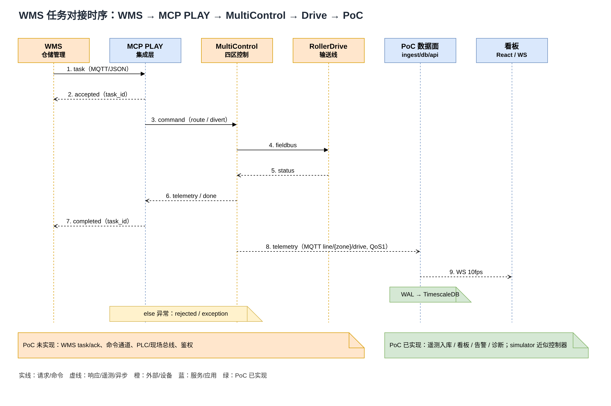

# WMS 任务流与 JD 能力差距

> 时序图：[时序-WMS任务对接.drawio](../design/diagrams/时序-WMS任务对接.drawio) · [PNG](../design/diagrams/时序-WMS任务对接.png)
> 实现级 DFD：[DFD-3-WMS任务与命令.drawio](../design/diagrams/DFD-3-WMS任务与命令.drawio) · [PNG](../design/diagrams/DFD-3-WMS任务与命令.png)
> 架构对应图：[架构-PoC与WMS对应.drawio](../design/diagrams/架构-PoC与WMS对应.drawio)

## 读图

- **1–7 是 WMS 任务闭环**：`task` → `accepted` → `command` → `fieldbus` → `status` → `telemetry/done` → `completed`。
- **8 是 PoC 的入口**：MultiControl/Drive 的遥测经 MQTT 进入 PoC；**PoC 不参与 task/command**。
- **9 是看板**：WS 10fps。
- **实线**：请求/命令；**虚线**：响应/遥测/异步。
- **else**：任务异常时 WMS 收到 `rejected / exception`。
- 底部两条 note：PoC 已实现 vs 未实现。

## JD 能力对照

| 能力 | PoC 现状 | 缺口 | 补法 |
|---|---|---|---|
| React + Python + MQTT + TimescaleDB + Docker | ✅ 已覆盖 | 无 | 保持 |
| **WMS 对接（task/ack, MQTT）** | ❌ 只有遥测 | 缺 WMS adapter、`tasks` 表、任务状态机、ack/重试、`task_id` 幂等 | `tasks` 表 + `POST /api/wms/tasks` + `wms/task` / `wms/task/ack` |
| **MCP PLAY / MultiControl 命令通道** | ❌ 只有遥测 | 缺 command topic、设备 ACK、命令幂等、状态回传 | `line/{zone}/drive/{id}/cmd` + `cmd/ack`；simulator 订阅 |
| **PLC / 现场总线**（PROFINET/EtherCAT/Modbus/OPC UA） | ❌ 只有 MQTT | 缺协议网关 | 边缘网关：OPC UA/Modbus → MQTT |
| 规划 / 调试 / 运行三件套 | 🟡 只覆盖运行期监控/诊断 | 缺规划配置、调试向导、参数下发 | 先做“运行”，规划/调试作为后续 |
| 现场部署（Windows 工控机/离线/PyInstaller） | 🟡 Docker/Linux 可用 | 缺 Windows 服务、离线安装、签名 | 打包安装器；或评估 WSL/Docker Desktop |
| 诊断 / 回滚 | ✅ diag/rollback | 🟡 缺 Windows 服务/自动升级 | 保留 diag/rollback，补安装器 |
| 安全（mTLS/JWT/ACL/审计） | ❌ 无鉴权 | 缺 WMS 接口鉴权、设备证书 | mTLS + JWT + ACL + audit |
| 告警治理（去抖/抑制/升级/通知） | 🟡 30s 去抖/离线 | 缺抑制窗口、升级策略、通知渠道 | 补告警治理层 |
| 多站点/中心汇聚 | 🟡 forwarder/center | 缺多租户/权限/中心 HA | 中心库 + 租户/权限；HA 后续 |
| AI 辅助查询 | ❌ 未做 | 缺 LLM/Text2SQL | 可选；先做规则查询 |
| 自动化测试/CI | ❌ 脚本级 | 缺 pytest/smoke/CI | 补单测/smoke/CI |

## 最小补齐顺序

1. **WMS mock task**：加 `tasks` 表、`POST /api/wms/tasks`、`wms/task` 和 `wms/task/ack`；`task_id` 唯一，重复下发返回同一条。  
   这一步就能在面试里讲“PoC 能接 WMS task，不是只有遥测”。
2. **命令通道**：`line/{zone}/drive/{id}/cmd` + `cmd/ack`；simulator 订阅命令并回状态；命令 ID 幂等。  
   这一步把“只读遥测”变成“可下发/可确认”的闭环。
3. **安全与交付**：mTLS/JWT、ACL、审计；Windows/离线安装；最后再接 PLC/OPC UA 网关。

## 面试口径

> “我的 PoC 是数据面切片：遥测、WAL、幂等、时序库、看板、诊断。JD 里的 WMS task/ack、命令通道、PLC/总线、鉴权、Windows 打包是缺口，我不会说 PoC 已经覆盖。缺口怎么补我也清楚：`task_id` 幂等、command/ack 状态机、mTLS/JWT、PLC 网关；这些是在 PoC 的 MQTT + 幂等 + 状态机上往上加，不是重写。”

一句话：**PoC 证明了“数据面”能做扎实；WMS/MCP PLAY/PLC/安全/交付是下一层，面试时主动画出来、说清楚补法，比假装都有更加分。**
