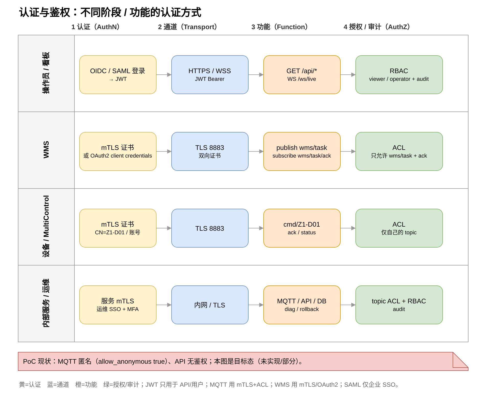

# 认证与鉴权：阶段 / 功能对照

> 源图：[流程-认证与鉴权.drawio](../design/diagrams/流程-认证与鉴权.drawio) · [PNG](../design/diagrams/流程-认证与鉴权.png)
> 相关：[WMS任务流与JD差距](WMS任务流与JD差距.md)

## 四段

| 阶段 | 解决的问题 | 典型手段 |
|---|---|---|
| 1 认证（AuthN） | 你是谁 | OIDC/SAML、mTLS 证书、账号密码、OAuth2 client credentials |
| 2 通道（Transport） | 链路是否被窃听/篡改 | HTTPS/WSS、TLS 8883、mTLS、国密 GM/TLS |
| 3 功能（Function） | 你能调什么 | `/api/*`、`/ws/live`、`wms/task`、`cmd/{id}`、diag |
| 4 授权/审计（AuthZ） | 你能操作哪些资源、做过什么 | API RBAC、MQTT topic ACL、审计日志 |

## 按角色看

| 角色 | 认证 | 通道 | 功能 | 授权 |
|---|---|---|---|---|
| 操作员/看板 | OIDC/SAML 登录 → JWT | HTTPS/WSS + JWT Bearer | `GET /api/*`、`WS /ws/live` | RBAC（viewer/operator）+ audit |
| WMS | mTLS 证书 / OAuth2 client credentials | TLS 8883（双向证书） | publish `wms/task`、subscribe `wms/task/ack` | ACL：只允许 `wms/task` + ack |
| 设备/MultiControl | mTLS 证书（CN=Z1-D01）/ 账号 | TLS 8883 | `cmd/Z1-D01`、`ack/status` | ACL：仅自己的 topic |
| 内部服务/运维 | 服务 mTLS / 运维 SSO+MFA | 内网/TLS | MQTT/API/DB、diag/rollback | topic ACL + RBAC + audit |

## 几个概念别混

| 名词 | 是什么 | 用在哪 |
|---|---|---|
| **JWT** | 签名令牌（header.payload.signature），带 `sub/exp/scope` | 浏览器/API、服务间 OAuth2 |
| **mTLS** | 双向 TLS，客户端也出示证书；握手非对称、数据对称 | 设备、WMS、服务间 |
| **ACL** | MQTT topic 级授权 | Broker（mosquitto/EMQX） |
| **SAML** | 企业 SSO（XML、浏览器重定向） | 操作员登录、SAP 等 |
| **国密** | SM2/SM3/SM4、GM/TLS 双证书 | 国内合规要求，可选 |

**JWT 默认只签名不加密**，payload 可读，必须走 HTTPS/WSS；不要把密码/密钥放进去。

## PoC 现状

- MQTT：`allow_anonymous true`，**匿名**；
- API：**无鉴权**；
- WMS：**未接**；
- 设备：无证书；
- 结论：本图是**目标态**，PoC 全部是缺口。

## 最小落地顺序

1. 关匿名：`allow_anonymous false` + `password_file` + `acl_file`；
2. 8883 + TLS/mTLS：WMS、设备、内部服务；
3. API：OIDC 登录 + JWT Bearer + RBAC；
4. WMS：按对方能力选 mTLS / OAuth2 client credentials / API Key + HMAC；
5. 审计：任务/命令/登录/回滚写 `events` 或独立 audit 表。

## 面试口径

> “安全分四段：认证、通道、功能、授权/审计。JWT 是 API/用户认证的一种；WMS 到边缘常用 mTLS + OAuth2 client credentials；设备用 mTLS 证书 + topic ACL；SAML 是企业 SSO，不用于 MQTT 设备；国密是合规密码套件，不是 JWT 替代品。PoC 现在匿名、API 无鉴权，接 WMS 前必须先把 `allow_anonymous` 关掉、加 ACL、上 8883 的 mTLS。”
